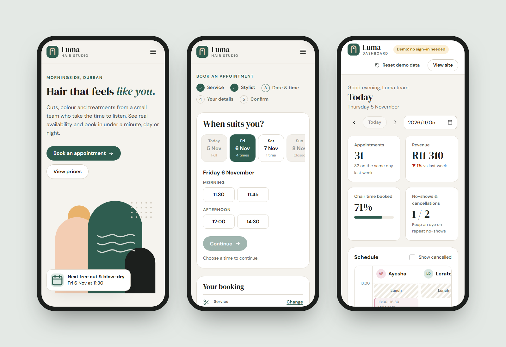
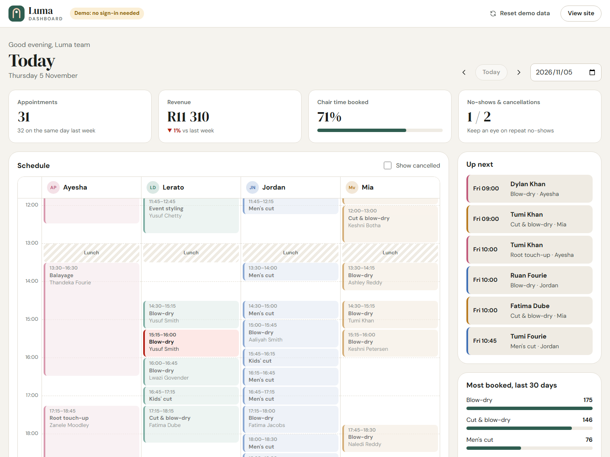

# Luma Hair Studio

**Live app: [notdeshlan.github.io/luma-studio](https://notdeshlan.github.io/luma-studio/)** · **[Salon dashboard](https://notdeshlan.github.io/luma-studio/#/admin)**

An online booking app for a fictional hair salon in Durban, built with React and TypeScript. Customers see real availability, book in a few taps and manage their own appointments. The salon gets a live dashboard with a day schedule, takings and no-show tracking.





## What it does

**For customers**
- **Live availability.** Times come from each stylist's working days, the salon's hours, a lunch break, existing bookings and the length of the service. A 3-hour balayage only shows times when a 3-hour gap really exists.
- **"First available stylist".** Offers every free time across the team, then gives the booking to whoever is least busy that day.
- **Five-step booking flow** with a running summary, editable steps, inline validation for South African mobile numbers, and focus management for keyboard and screen reader users.
- **Self-service:** look up bookings by email, change the time (your own slot doesn't count as busy), cancel, or download an `.ics` file to add it to any calendar.
- **Deep links** such as `#/book?service=balayage&stylist=ayesha` from the price list and team pages.

**For the salon** (`#/admin`, no sign-in in the demo)
- A day schedule with one column per stylist, lunch breaks, days off and a live "now" line.
- Click any appointment to mark it done, record a no-show, cancel it or restore it. Restoring checks for clashes first.
- Day KPIs (appointments, revenue against the same day last week, chair time booked, no-shows) plus a two-week revenue chart and the most-booked services.
- Open the site and the dashboard in two tabs, make a booking, and it appears on the dashboard straight away.

**Also:** light and dark themes that follow the device setting, works from 320px phones up, and the dashboard code is only downloaded when someone opens it.

## How it's built

React 19, TypeScript and React Router, bundled with Vite. There's no backend: `src/lib/store.ts` keeps bookings in `localStorage` behind a small store API (`add`, `update`, `replace`, `reset`). The UI only talks to that API, so swapping in a real server later is contained to one file. On first visit it generates about eight weeks of realistic demo bookings around today's date.

| Path | What it does |
| --- | --- |
| `src/lib/availability.ts` | The scheduling engine: free slots, "any stylist" assignment, clash detection |
| `src/lib/bookings.ts` | Creating, moving and cancelling bookings, with the rules for each |
| `src/lib/store.ts` | Persistence and cross-tab sync, exposed as React hooks |
| `src/lib/demo-data.ts` | Seeded, repeatable demo bookings weighted by how popular each service is |
| `src/pages/book/` | The booking wizard and date/time picker |
| `src/pages/admin/` | Dashboard, schedule grid and appointment panel |

**Tests:** 29 tests with Vitest and Testing Library. Unit tests cover the availability rules (opening hours, lunch, lead time, overlaps, cancellations, late Thursdays), booking changes, validation and the calendar file. Component tests drive the real UI: a full booking, validation errors, cancelling, email lookup and the dashboard.

## Run it locally

Needs Node.js 20 or later.

```bash
npm install
npm run dev
```

Then open http://localhost:5173.

```bash
npm test
```

```bash
npm run build
```

## Deploy

Push to `main` on GitHub and set **Settings → Pages → Source** to **GitHub Actions**. The workflow tests, builds and publishes. Routes use `#/` URLs, so every page works on static hosting without server rewrites.

---

Luma Hair Studio, its staff and its customers are fictional. Designed and built by [Deshlan P.](https://www.upwork.com/freelancers/~0136f319881683d143)
